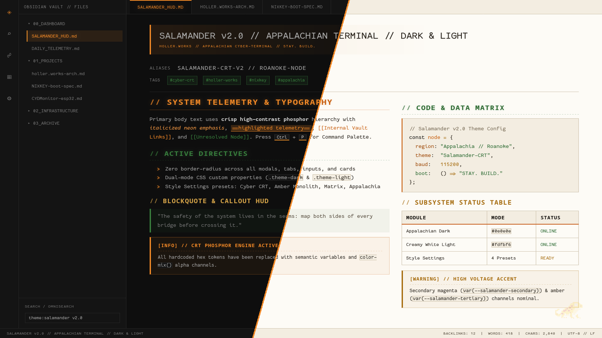

# Salamander — Appalachian Terminal Theme for Obsidian

**Salamander** is a high-contrast, monospace-first terminal theme for [Obsidian](https://obsidian.md) inspired by Appalachia's prolific amphibian.

- **Dark Mode (`.theme-dark`)**: Carbon black (`#0e0e0e`), Appalachian Rust Orange (`#f28927`), Forest Pine Green (`#39803e`), and Warm Ochre (`#d9a74a`).
- **Light Mode (`.theme-light`)**: Glare-free Creamy White parchment (`#fdfbf6`), Warm Oat-Cream sidebars (`#f3ede1`), Deep Appalachian Rust (`#c86010`), and Forest Pine (`#2b6930`).
- **Sharp Terminal Geometry**: Zero border-radius across tabs, modals, callouts, code blocks, and inputs.
- **Telemetry Typography**: Uppercase `// ` prefixed headings, `>` list markers, and full Nerd Font / monospace support.
- **Style Settings Compatible**: Includes built-in palette presets (**Appalachian Terminal**, **Phosphor Amber Monolith**, **Cyberpunk / CRT Phosphor**, and **Matrix Telemetry**), CRT scanline toggles, phosphor glow controls, and watermark opacity sliders via the [Style Settings](https://github.com/mgmeyers/obsidian-style-settings) plugin.

## Installation

### From Obsidian Community Themes
1. Open **Settings → Appearance → Themes → Manage**.
2. Search for **Salamander** and click **Install and use**.

### Manual Installation
1. Download `theme.css` and `manifest.json` from the latest GitHub Release.
2. Place both files in `<Your Vault>/.obsidian/themes/Salamander/`.
3. Enable **Salamander** under **Settings → Appearance → Themes**.

## License

[MIT License](LICENSE) — Created by [Jason](https://holler.works).
